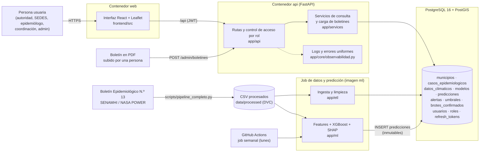

# Arquitectura actual del MVP (TASK-042)

Describe **lo que existe y corre hoy**, no lo aspiracional. Cada caja indica su código en el repositorio. Los diagramas C4 del Sprint 1 ([`c4/`](./c4/)) muestran el diseño objetivo; este documento es el que debe coincidir con la demostración.

Estado al 2026-10-26: la API está desplegada en **Render** con la base en **Neon** (TASK-004, [ADR-006](./adr/ADR-006-despliegue-render-neon.md)); la predicción semanal corre en **GitHub Actions** (TASK-016). La interfaz corre en local (`npm run dev`, o `npm run dev:render` contra la API desplegada) y todavía no está publicada. La demostración se hace en local con el mismo código.

Lectura del flujo observable en la demostración: **persona → interfaz → API → servicios → base de datos ← modelo**. La API nunca ejecuta el modelo: lee las predicciones que el job guardó.

## Contenedores y dónde está su código

| Pieza | Qué hace | Código | Se ejecuta con |
|---|---|---|---|
| Interfaz | Login, resumen, mapa, detalle por rol, alertas, historial, carga de boletines | `dengue-malaria-prediccion/frontend/` | `npm run dev` · imagen `web` (nginx) |
| API | Autenticación, RBAC, consultas y carga de boletines en PDF | `dengue-malaria-prediccion/app/` | `uvicorn app.main:app` · imagen `api` · Render |
| Base de datos | Datos, predicciones y usuarios | `alembic/` (migraciones) | PostGIS local, `docker compose up db` o Neon |
| Ingesta y limpieza | CSV procesados → tablas; PDF de boletín → tablas | `app/etl/`, `scripts/` | `python -m app.etl.seed_demo --todos-los-municipios --fecha 2026-03-30` · pestaña Datos |
| Modelo | Features, predicción y explicación | `app/ml/` | `python -m app.ml.job_semanal` · imagen `ml` · GitHub Actions (`.github/workflows/prediccion_semanal.yml`) |
| Datos versionados | Pipeline reproducible | `dvc.yaml`, `scripts/pipeline_completo.py` | `python scripts/pipeline_completo.py` |

## Qué es código, qué es configuración y qué es secreto

| Tipo | Ejemplos | Dónde vive | ¿Se versiona? |
|---|---|---|---|
| Código | `app/`, `frontend/src/`, `alembic/` | Repositorio | Sí |
| Configuración (no secreta) | `LOG_LEVEL`, `DB_*_TIMEOUT`, `ACCESS_TOKEN_EXPIRE_MINUTES`, `ENVIRONMENT` | Variables de entorno; plantilla en `.env.example` | Solo la plantilla |
| **Secretos** | `DATABASE_URL`, `SECRET_KEY`, `SEED_DEMO_PASSWORD` | Variables de entorno o `.env` local | **Nunca** (`.env` está ignorado) |

`SECRET_KEY` y `DATABASE_URL` no tienen valor por defecto: si faltan, la aplicación no arranca (`app/core/config.py`). Con `ENVIRONMENT=production` se rechaza una clave débil.

## Decisiones que explican la forma del sistema

- **Una sola base y una API de lectura:** el modelo escribe predicciones y la API solo las consulta, así que la interfaz no depende de que el modelo esté corriendo ([ADR-001](./adr/ADR-001-postgresql-postgis.md), [ADR-002](./adr/ADR-002-python-fastapi.md)).
- **Predicciones inmutables:** solo `INSERT`, para auditoría (NFR-009).
- **Control de acceso en el servidor:** la vista resumida no recibe los campos técnicos; no se ocultan en la interfaz (REQ-007).
- **Malaria sin modelo:** solo hay acumulados, así que se muestran casos observados ([ADR-005](./adr/ADR-005-malaria-acumulado-en-bd.md)).

## Diferencias con el diseño original (`design.md`)

| Diseño original | Realidad hoy |
|---|---|
| Dashboard con selector de agregación zona, municipio y departamento | Municipio y departamento (la «zona» es el municipio); por departamento se muestra el peor caso, no una predicción nueva |
| Ingesta por `POST /datos/clima` y `/datos/casos` | Casos: por comando (`app/etl`) o subiendo el PDF del boletín (`POST /admin/boletines`, verificado contra los totales impresos). Clima: solo por el pipeline de datos |
| `GET /campanas/priorizacion` y `/municipios/{id}/recursos` | Implementados (TASK-024 y 025); las reglas de riesgo y las recomendaciones son provisionales |
| Tarea programada semanal en Railway | GitHub Actions cada lunes (TASK-016), porque el servicio gratuito de Render se duerme |
| Despliegue en Railway | Render + Neon (TASK-004, ADR-006); la interfaz todavía no está publicada |
| Zona piloto de 4 municipios | La demo carga los 42 municipios con casos del boletín (28 con dengue, 21 con malaria; ADR-007) |
| El modelo lee de la base | El modelo lee el panel semanal del pipeline (casos + clima); subir un boletín actualiza los casos, no las predicciones |
