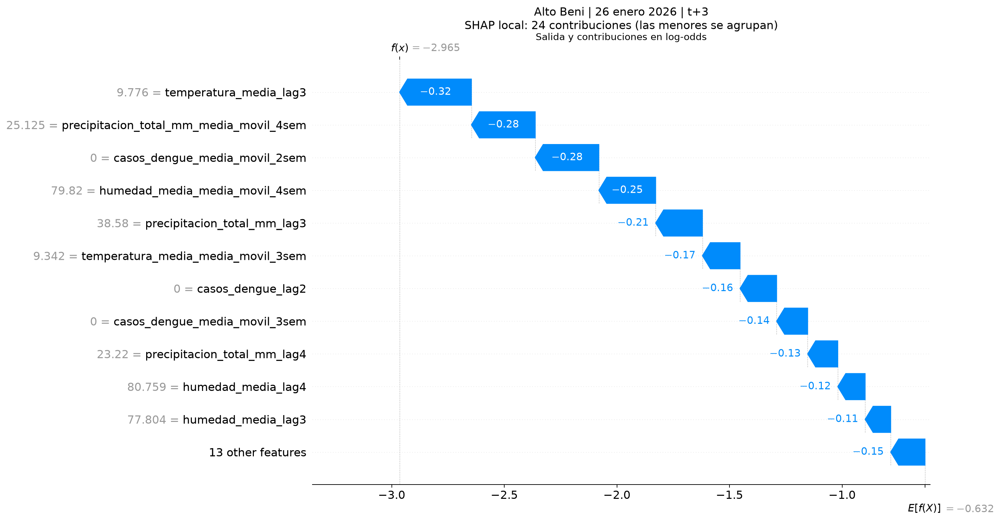
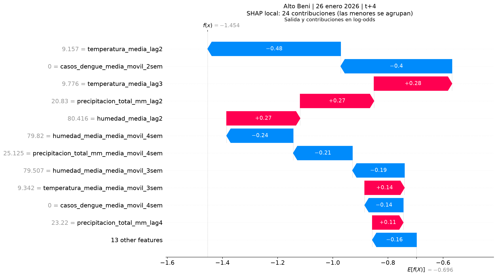
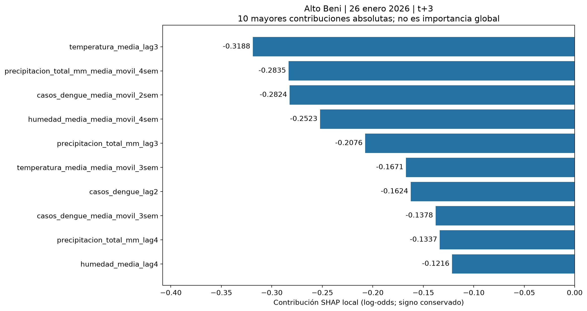
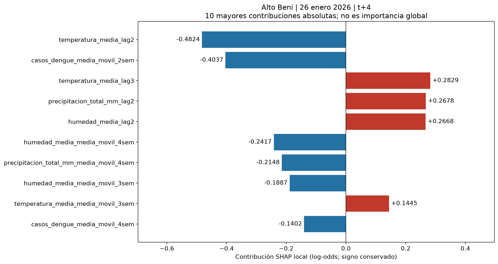
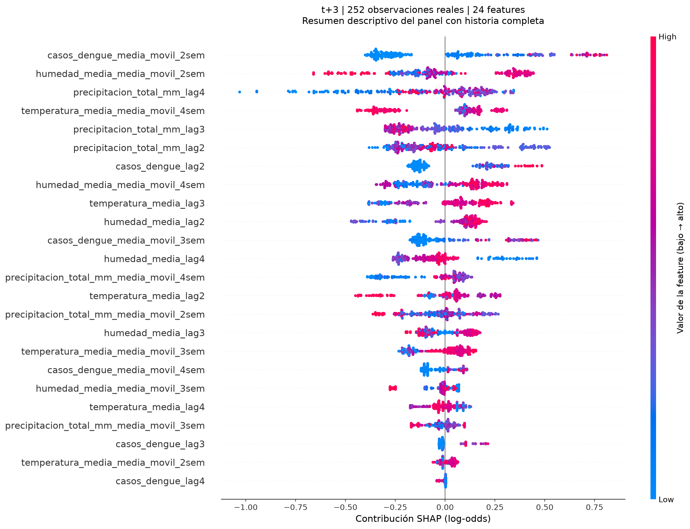
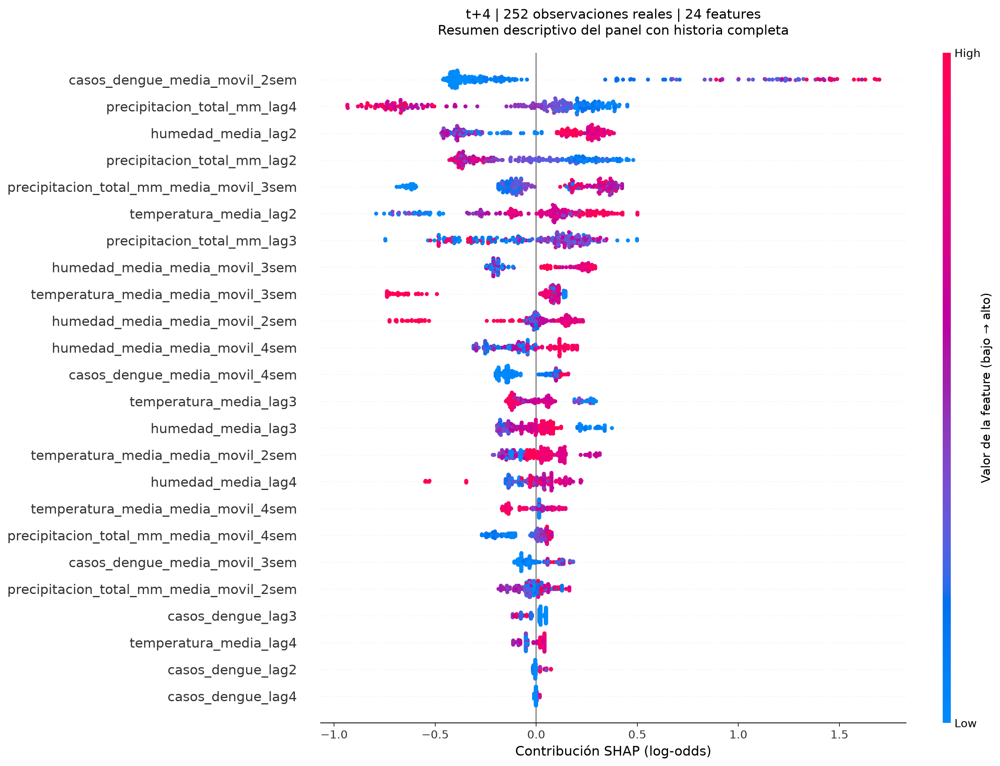
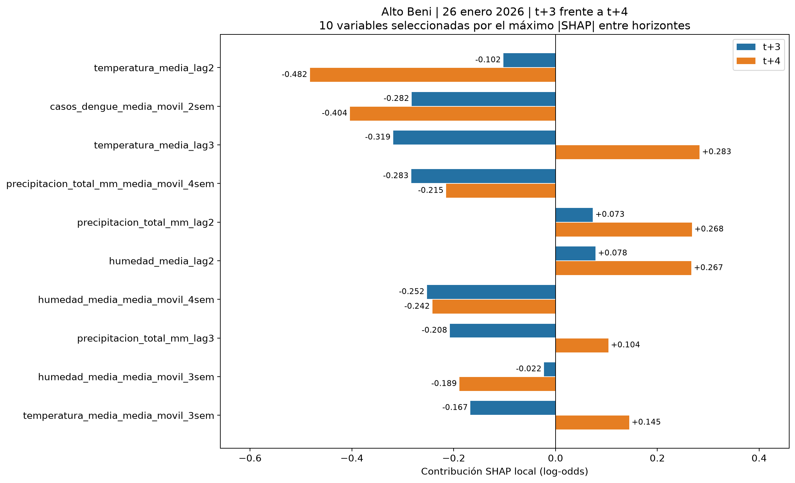

# Reproducción de evidencia SHAP de TASK-013

Ejecutar desde la raíz del repositorio en PowerShell, con las dependencias
ya disponibles en `.venv`. El bloque Python de este documento es el generador:
solo lee código, artefactos y datos; escribe PNG y documentación en esta carpeta.
No entrena modelos ni instala dependencias. No crea archivos de código Python.

```powershell
$OutputEncoding = [System.Text.UTF8Encoding]::new($false)
$documento = Get-Content -Raw -Encoding UTF8 docs/evidencias/reproducir_shap.md
$codigo = [regex]::Match($documento, '(?s)```python\r?\n(.*)\r?\n```\s*$').Groups[1].Value
$codigo | ./.venv/Scripts/python.exe -B -
```

```python
from pathlib import Path
import sys
import math
import hashlib
import importlib.metadata
import numpy as np
import matplotlib
matplotlib.use('Agg')
import matplotlib.pyplot as plt
import shap
import xgboost

raiz = Path.cwd()
sys.path.insert(0, str(raiz / 'dengue-malaria-prediccion'))
from app.ml.features import cargar_features, DATASET_DENGUE
from app.ml.entrenamiento import cargar_artefacto, predecir_probabilidad
from app.ml.explicabilidad import explicar_observaciones

salida = raiz / 'docs/evidencias/shap'
salida.mkdir(parents=True, exist_ok=True)
plt.rcParams.update({'font.size': 11, 'savefig.dpi': 180})
resultado = cargar_features()
claves = resultado.claves
mascara = (claves.municipio.eq('alto beni') &
           claves.fecha_semana.eq('2026-01-26'))
assert mascara.sum() == 1, 'La observación debe ser única.'
indice = claves.index[mascara][0]
completas = resultado.features.notna().all(axis=1)
X = resultado.features.loc[completas].copy()
assert indice in X.index and len(X) > 1
posicion = X.index.get_loc(indice)
fila = X.loc[[indice]]
n = len(X)
resumen = {}
pesos_locales = {}
fuentes = [DATASET_DENGUE,
           raiz / 'dengue-malaria-prediccion/app/ml/features.py',
           raiz / 'dengue-malaria-prediccion/app/ml/entrenamiento.py',
           raiz / 'dengue-malaria-prediccion/app/ml/explicabilidad.py']
huellas = {str(p.relative_to(raiz)): hashlib.sha256(p.read_bytes()).hexdigest()
           for p in fuentes}

def guardar(nombre):
    plt.savefig(salida / nombre, bbox_inches='tight', facecolor='white')
    plt.close('all')

for h in (3, 4):
    artefacto = cargar_artefacto(h)
    assert list(X.columns) == artefacto.features == artefacto.metadata['features']
    assert len(artefacto.features) == 24
    for p in (artefacto.ruta_modelo,
              artefacto.ruta_modelo.with_name(artefacto.ruta_modelo.stem + '_metadata.json')):
        huellas[str(p.relative_to(raiz))] = hashlib.sha256(p.read_bytes()).hexdigest()
    respuestas = explicar_observaciones(X, h)
    # Reconstruir la matriz por nombre: el módulo devuelve rankings locales.
    pesos = np.array([[dict((e['variable'], e['peso']) for e in r['explicaciones'])[c]
                       for c in artefacto.features] for r in respuestas])
    bases = np.array([r['valor_base'] for r in respuestas])
    margenes = artefacto.modelo.predict(
        xgboost.DMatrix(X, feature_names=artefacto.features, missing=np.nan),
        output_margin=True)
    np.testing.assert_allclose(bases + pesos.sum(axis=1), margenes,
                               rtol=1e-5, atol=1e-5)
    probabilidades = predecir_probabilidad(artefacto, X)
    np.testing.assert_allclose(1 / (1 + np.exp(-margenes)), probabilidades,
                               rtol=1e-6, atol=1e-7)
    r = respuestas[posicion]
    local = pesos[posicion]
    pesos_locales[h] = local
    reconstruida = r['valor_base'] + math.fsum(local)
    resumen[h] = {'respuesta': r, 'probabilidad': float(probabilidades[posicion]),
                  'suma': math.fsum(local), 'reconstruida': reconstruida,
                  'error': abs(reconstruida - r['salida_modelo']),
                  'error_max_lote': float(np.max(np.abs(bases + pesos.sum(axis=1) - margenes)))}
    explicacion = shap.Explanation(values=local, base_values=r['valor_base'],
        data=fila.iloc[0].to_numpy(), feature_names=artefacto.features)
    shap.plots.waterfall(explicacion, max_display=12, show=False)
    plt.gcf().set_size_inches(13, 9)
    plt.title(f'Alto Beni | 26 enero 2026 | t+{h}\n'
              'SHAP local: 24 contribuciones (las menores se agrupan)', pad=36)
    plt.xlabel('Salida y contribuciones en log-odds')
    guardar(f'waterfall_t{h}.png')

    seleccion = np.argsort(-np.abs(local), kind='stable')[:10]
    fig, ax = plt.subplots(figsize=(13, 7))
    valores = local[seleccion]
    barras = ax.barh(np.arange(10), valores,
        color=['#c0392b' if v > 0 else '#2471a3' for v in valores])
    np.testing.assert_allclose([b.get_width() for b in barras], valores)
    ax.set_yticks(np.arange(10), np.array(artefacto.features)[seleccion])
    ax.invert_yaxis()
    ax.axvline(0, color='black', linewidth=0.8)
    ax.bar_label(barras, labels=[f'{v:+.4f}' for v in valores], padding=4)
    ax.margins(x=0.28)
    ax.set_xlabel('Contribución SHAP local (log-odds; signo conservado)')
    ax.set_title(f'Alto Beni | 26 enero 2026 | t+{h}\n'
                 '10 mayores contribuciones absolutas; no es importancia global')
    fig.tight_layout()
    guardar(f'importancia_t{h}.png')

    explicaciones = shap.Explanation(values=pesos, base_values=bases,
        data=X.to_numpy(), feature_names=artefacto.features)
    np.random.seed(42)  # Solo fija el desplazamiento visual de los puntos.
    shap.plots.beeswarm(explicaciones, max_display=24, show=False,
        plot_size=(13, 12), color_bar_label='Valor de la feature (bajo → alto)')
    plt.title(f't+{h} | {n} observaciones reales | 24 features\n'
              'Resumen descriptivo del panel con historia completa', pad=18)
    plt.xlabel('Contribución SHAP (log-odds)')
    guardar(f'summary_t{h}.png')
    print(f't+{h}: p={resumen[h]["probabilidad"]:.10f}; '
          f'base={r["valor_base"]:.10f}; margen={r["salida_modelo"]:.10f}; '
          f'error local={resumen[h]["error"]:.3e}; '
          f'error máximo ({n} filas)={resumen[h]["error_max_lote"]:.3e}')

seleccion = np.argsort(-np.maximum(np.abs(pesos_locales[3]),
                                  np.abs(pesos_locales[4])), kind='stable')[:10]
fig, ax = plt.subplots(figsize=(13, 8))
y = np.arange(len(seleccion))
for h, desplazamiento, color in ((3, -0.19, '#2471a3'), (4, 0.19, '#e67e22')):
    valores = pesos_locales[h][seleccion]
    barras = ax.barh(y + desplazamiento, valores, height=0.36,
                    label=f't+{h}', color=color)
    np.testing.assert_allclose([b.get_width() for b in barras], valores)
    ax.bar_label(barras, labels=[f'{v:+.3f}' for v in valores], padding=3, fontsize=9)
ax.set_yticks(y, np.array(X.columns)[seleccion])
ax.invert_yaxis()
ax.axvline(0, color='black', linewidth=0.8)
ax.margins(x=0.23)
ax.set_xlabel('Contribución SHAP local (log-odds)')
ax.set_title('Alto Beni | 26 enero 2026 | t+3 frente a t+4\n'
             '10 variables seleccionadas por el máximo |SHAP| entre horizontes')
ax.legend()
fig.tight_layout()
guardar('comparacion_t3_t4.png')

texto = '''# TASK-013: evidencia real SHAP para la segunda defensa de GatoByte

## Objetivo y método

TASK-013 explica cada predicción de XGBoost mediante contribuciones locales
SHAP. Se utiliza `TreeExplainer` sobre los Booster reales de Ivonne, con
`model_output="raw"` y `feature_perturbation="tree_path_dependent"`.
La referencia se obtiene de las frecuencias de entrenamiento de las rutas
de los árboles; no se introduce un dataset simulado de fondo.

Los pesos positivos elevan el margen respecto al valor base y los negativos
lo reducen. La escala es **log-odds**, no porcentajes. La sigmoide del margen
completo produce la probabilidad de al menos un caso de dengue en t+h.
No se aplica la sigmoide a cada peso por separado.

## Modelos, datos y observación

- Modelos: `dengue-malaria-prediccion/app/ml/artifacts/baseline_dengue_t3_v1.json`
  y `baseline_dengue_t4_v1.json`, con sus metadatos v1.
- Dataset: `data/processed/panel_semanal_dengue_clima.csv`.
- Pipeline: `app.ml.features.cargar_features()` (TASK-011).
- Explicaciones: `app.ml.explicabilidad.explicar_observaciones()` (TASK-013).
- Observación local: **Alto Beni, 26 de enero de 2026**, con 24 features sin NaN.
- Se verificó identidad y orden de las 24 columnas entre pipeline, metadatos
  y Booster. Los nombres originales de las variables se conservan en las imágenes.
- No se entrenó ningún modelo ni se modificaron las fuentes.

'''
texto += (f'Los beeswarm utilizan **{n} observaciones reales**, de '
          f'{claves.loc[X.index, "municipio"].nunique()} municipios, entre '
          f'{claves.loc[X.index, "fecha_semana"].min().date()} y '
          f'{claves.loc[X.index, "fecha_semana"].max().date()}. '
          f'Se seleccionan filas con las 24 features disponibles: {len(claves)-n} '
          'filas del panel quedan fuera por historia o valores incompletos. '
          'Se usa exactamente el mismo subconjunto para ambos horizontes; '
          'no se exige objetivo futuro porque se describe el modelo, no se evalúa su acierto.\n\n')
texto += '## Resultados numéricos y aditividad\n\n'
texto += '| Métrica | t+3 | t+4 |\n|---|---:|---:|\n'
for etiqueta, funcion in (
    ('Probabilidad de al menos un caso', lambda d: f'{100*d["probabilidad"]:.6f} %'),
    ('Valor base (log-odds)', lambda d: f'{d["respuesta"]["valor_base"]:.10f}'),
    ('Salida real / margen (log-odds)', lambda d: f'{d["respuesta"]["salida_modelo"]:.10f}'),
    ('Suma de los 24 pesos', lambda d: f'{d["suma"]:.10f}'),
    ('Base + suma de pesos', lambda d: f'{d["reconstruida"]:.10f}'),
    ('Error absoluto local', lambda d: f'{d["error"]:.3e}'),
    ('Error máximo del lote', lambda d: f'{d["error_max_lote"]:.3e}')):
    texto += f'| {etiqueta} | {funcion(resumen[3])} | {funcion(resumen[4])} |\n'
texto += ('\n**Aditividad: OK en ambos horizontes y en todas las filas analizadas.** '
          'Se verifica `base + suma(24 pesos) ≈ margen` con `rtol=1e-5` y '
          '`atol=1e-5`. Las pequeñas diferencias son de precisión numérica. '
          'También se verifica que la sigmoide del margen coincide con '
          '`predecir_probabilidad()`.\n\n')
for h in (3, 4):
    texto += f'### Cinco contribuciones locales principales: t+{h}\n\n'
    texto += '| Variable | Peso (log-odds) |\n|---|---:|\n'
    for item in resumen[h]['respuesta']['explicaciones'][:5]:
        texto += f'| `{item["variable"]}` | {item["peso"]:+.10f} |\n'
    texto += '\n'
texto += '''## Lectura de las visualizaciones

### Waterfall: del valor base a la salida local

Incluyen las 24 contribuciones: las mayores se muestran individualmente y
las restantes se suman en una barra. El extremo final corresponde al margen,
no a la probabilidad. En t+3 las cinco mayores contribuciones reducen el margen;
en t+4 hay contribuciones de ambos signos.





### Barras: importancia local con signo

Muestran las 10 mayores contribuciones absolutas de Alto Beni, con sus signos
y valores numéricos. Azul reduce y rojo eleva el margen. No representan
importancia global ni incluyen la suma de las 14 variables omitidas.





### Beeswarm: distribución de explicaciones en el subconjunto

Cada punto representa una observación y cada fila una feature. La posición
horizontal es su contribución y el color representa su valor bajo/alto.
Las filas se ordenan por media de |SHAP| en el subconjunto. Este resumen
agregado describe esas observaciones; no es el ranking local de Alto Beni
ni una importancia global universal. Se muestran las 24 features.





### Comparación de horizontes

Compara los pesos locales sobre una escala común log-odds para las 10 features
con mayor máximo |SHAP| entre ambos modelos. Los colores identifican horizontes;
el signo indica dirección. Las bases son distintas y no se comparan aquí
probabilidades con contribuciones. Las diferencias describen dos modelos,
no un efecto temporal causal de una variable.



## Correspondencia entre gráficas y cifras

Todas las gráficas usan la misma matriz de contribuciones devuelta por TASK-013,
reconstruida por nombre en el orden exacto del artefacto. No se copiaron pesos
manualmente. Waterfall recibe las 24 contribuciones y su base; las barras y
la comparación verifican sus anchuras contra los pesos originales. El beeswarm
usa esa misma matriz y los valores reales de las features. Las tablas de este
informe se generan en la misma ejecución. El redondeo visual no se utiliza
para comprobar aditividad.

## Limitaciones

- SHAP explica el comportamiento del modelo; no demuestra causalidad ni
  justifica decisiones sanitarias por sí solo.
- Los pesos no son porcentajes, cantidades de casos o probabilidades de brote.
  La etiqueta es presencia de al menos un caso de dengue, no brote ni malaria.
- Los modelos finales se ajustaron sobre todas las filas elegibles del panel.
  Esta demostración **no constituye validación predictiva fuera de muestra**,
  ni reproduce los modelos históricos de cada origen walk-forward.
- El panel original contiene solo 13 semanas de 2026. No demuestra
  generalización entre años, estaciones o territorios no representados.
- Los rezagos y las medias móviles están correlacionados: la atribución depende
  del modelo y del método de referencia. No debe leerse como un efecto aislado.
- El resumen excluye filas incompletas por claridad visual. No se imputaron
  datos; el modelo y TASK-013 admiten NaN, pero aquí se analiza otro subconjunto.
- Las probabilidades mostradas son salidas del modelo, no garantías calibradas
  de ocurrencia ni niveles de riesgo operativos.

## Reproducción

Desde la raíz del repositorio en PowerShell:

```powershell
$OutputEncoding = [System.Text.UTF8Encoding]::new($false)
$documento = Get-Content -Raw -Encoding UTF8 docs/evidencias/reproducir_shap.md
$codigo = [regex]::Match($documento, '(?s)```python\\r?\\n(.*)\\r?\\n```\\s*$').Groups[1].Value
$codigo | ./.venv/Scripts/python.exe -B -
```

El generador completo está en [reproducir_shap.md](reproducir_shap.md).
No instala dependencias. Se fija la semilla solo para la distribución visual
de puntos del beeswarm, sin alterar datos, modelos o pesos.

'''
texto += '## Entorno de generación\n\n'
texto += f'- Python: {sys.version.split()[0]}\n'
for paquete in ('shap', 'xgboost', 'matplotlib', 'pandas', 'numpy'):
    texto += f'- {paquete}: {importlib.metadata.version(paquete)}\n'
texto += '\n## Trazabilidad SHA-256 de fuentes\n\n'
for nombre, huella in huellas.items():
    assert hashlib.sha256((raiz / nombre).read_bytes()).hexdigest() == huella
    texto += f'- `{nombre}`: `{huella}`\n'
texto += '\n## Archivos para guardar en Git\n\n'
texto += '- Este informe y `docs/evidencias/reproducir_shap.md`.\n'
texto += '- Los siete PNG de `docs/evidencias/shap/`. No requieren DVC.\n'
(salida.parent / 'shap_alto_beni.md').write_text(texto, encoding='utf-8')
print(f'Generadas 7 imágenes y el informe; beeswarm: {n} observaciones por horizonte.')
```
